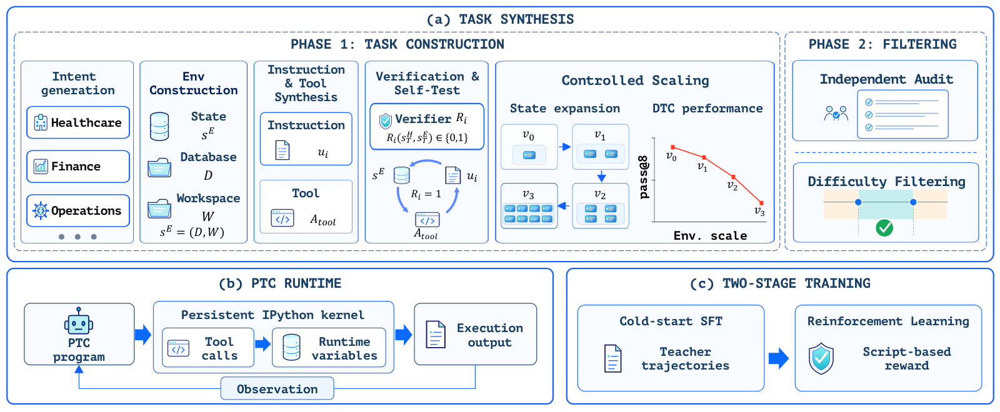
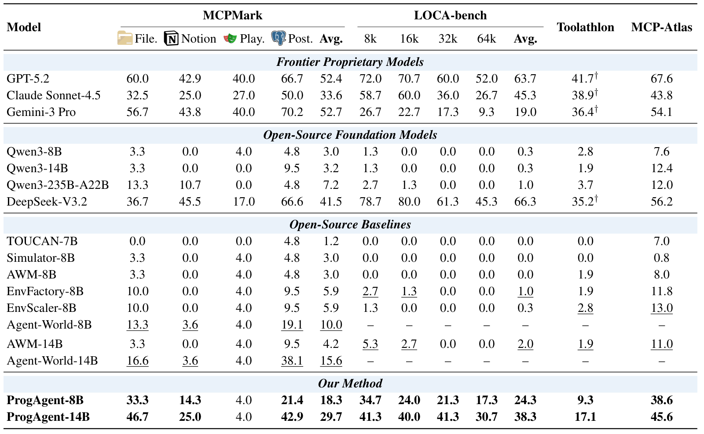

<div align="center">

# ProgAgent: Learning Tool Orchestration through Programmatic Training

**A full PTC training stack for long-horizon tool orchestration.**

[🌐 Project Website](https://llleoli.github.io/ProgAgent/) · [📄 Paper](https://llleoli.github.io/ProgAgent/assets/ProgAgent.pdf) · [🤗 Hugging Face](https://huggingface.co/collections/LLLeo612/progagent)

</div>

## Overview

ProgAgent trains language agents to orchestrate tools through executable Python programs. Intermediate tool results stay in runtime variables, while agents selectively print useful information into their context. Loops, conditionals, and error handling let agents coordinate dependent tool calls across long-horizon tasks.



The framework brings together three components:

- **Verifiable environments:** 215 tasks at four scales (`v0`–`v3`), yielding 860 task instances. Environment states grow while instructions, task logic, and tool schemas stay fixed.
- **Persistent programmatic tool calling (PTC):** an IPython runtime retains intermediate results across turns and returns printed outputs to the agent.
- **Two-stage training:** cold-start supervised fine-tuning (SFT) on teacher trajectories, followed by reinforcement learning (RL) with binary rewards from Python task verifiers.

The repository supports **programmatic tool calling (PTC)**, **direct tool calling (DTC)**, and **Hybrid** training. Experiments use Qwen3-8B and Qwen3-14B; additional Qwen3-Coder-30B-A3B training recipes are included.

## Results



Mean pass rates (%). ProgAgent uses PTC evaluation; baselines use DTC. Toolathlon scores marked † use the original benchmark; the others use Toolathlon-Verified.

After SFT and RL, PTC achieves the highest aggregate score among the three training paradigms on all four benchmarks at both model sizes. ProgAgent-14B maintains a **30.7%** pass rate on LOCA-bench at 64k environment-state size. See the [analysis](https://llleoli.github.io/ProgAgent/#analysis) and [tool-orchestration walkthrough](https://llleoli.github.io/ProgAgent/#examples) for training dynamics and a worked example.

## Benchmark evaluation

We provide evaluation implementations for the following benchmarks. See each repository for setup and usage instructions.

| Benchmark | Evaluation implementation |
| --- | --- |
| Toolathlon-Verified | [Toolathlon evaluation](https://github.com/hkust-nlp/Toolathlon/tree/toolathlon-verified-ptc) |
| LOCA-bench | [LOCA-bench evaluation](https://github.com/LLLeoLi/LOCA-bench) |

For evaluation on our synthesized training environments, see the [TaskSync guide](task-sync/README.md#evaluation-and-sft-export).

## Quick start

Run from the repository root. Use a compatible GPU environment with Megatron-SWIFT for SFT, and Megatron, mbridge, vLLM, and the sandbox dependencies for RL; installing this package alone does not configure the full training stack. See the [training guide](ptc_training_recipe/README.md) for model preparation, data downloads, and multi-node setup.

```bash
uv venv --python 3.12
source .venv/bin/activate
uv pip install -e .

# Prepare a local Qwen3-8B model, then train on downloaded SFT trajectories.
python ptc_training_recipe/prepare_qwen3.py --model /path/to/Qwen3-8B
bash ptc_training_recipe/sft/sft_qwen3_8b.sh \
  --model_path /path/to/Qwen3-8B \
  --data_path /path/to/ptc-thinking.jsonl \
  --output_dir /path/to/sft-output

# Use the checkpoint directory produced by SFT.
bash ptc_training_recipe/rl/train_megatron_qwen3_8b.sh \
  --model_path /path/to/sft-checkpoint \
  --train_files task-sync/environments/standard \
  --ptc_mode ptc
```

Use `--ptc_mode dtc` or `--ptc_mode hybrid` for the other interfaces. Adjust batch sizes and parallelism for your hardware. Qwen3-14B uses the corresponding `14b` scripts; Qwen3-Coder uses the `coder` scripts.

For multi-node training, configure the cluster environment and use the [multi-node launchers](ptc_training_recipe/README.md#multiple-nodes).

## Repository

| Path | Contents |
| --- | --- |
| [`ptc_training_recipe/`](ptc_training_recipe/README.md) | Model preparation, templates, and SFT/RL launchers |
| [`examples/train_verl_tasksync/`](examples/train_verl_tasksync/) | ProgAgent training entry point, dataset adapter, and configuration |
| [`verl/`](verl/) | Training framework and PTC/DTC agent loops |
| [`task-sync/`](task-sync/README.md) | Task environments, synthesis, and evaluation |

## Citation

If you use ProgAgent in your research, please cite:

```bibtex
@misc{li2026progagent,
  title = {ProgAgent: Learning Tool Orchestration through Programmatic Training},
  author = {Li, Hao and He, Keqing and Zheng, Longtao and Li, Junlong and Zeng, Weihao and Liu, Qian and Huang, Yuzhen},
  year = {2026},
  url = {https://llleoli.github.io/ProgAgent/}
}
```

## Acknowledgments

Built on [verl](https://github.com/verl-project/verl) and [GEM](https://github.com/axon-rl/gem), with [Megatron-SWIFT](https://github.com/modelscope/ms-swift), [Megatron-LM](https://github.com/NVIDIA/Megatron-LM), [mbridge](https://github.com/ISEEKYAN/mbridge), and [vLLM](https://github.com/vllm-project/vllm) for training and rollout.
